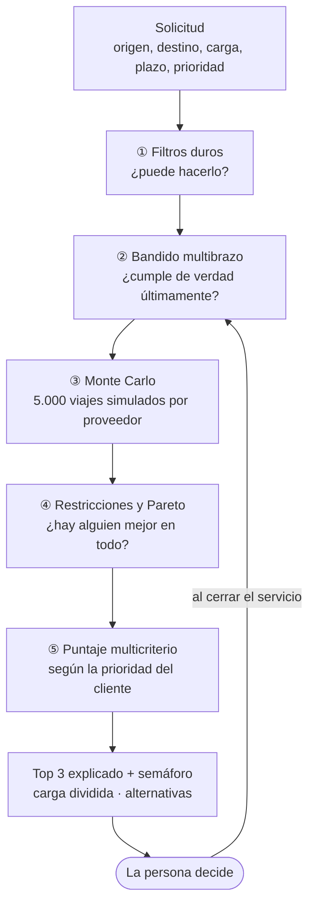
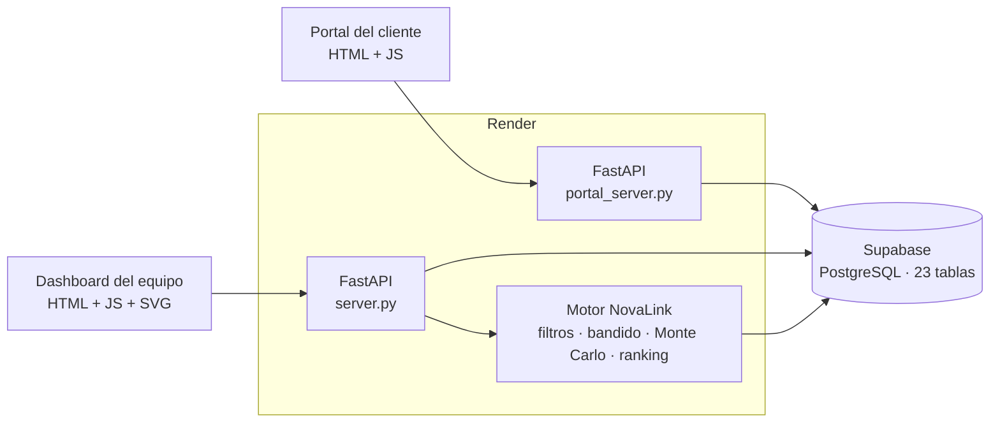

<div align="center">

# NovaLink

**Recomendación y selección de transportadoras terrestres en Colombia para COSCO SHIPPING**

Equipo **ingnova.com** · Sabana Hack 2026 · Universidad de La Sabana

[](https://cosco-dashboard.onrender.com/)
[](https://cosco-portal.onrender.com/)


</div>

---

## ¿Qué es?

Cada vez que COSCO necesita mover carga por tierra en Colombia (por ejemplo, *2 contenedores refrigerados de
Buenaventura a Bogotá para el lunes*), alguien tiene que escoger la transportadora. Hoy esa elección es manual.

**NovaLink la vuelve rápida, consistente y explicable.** Para cada solicitud entrega:

- un **ranking de proveedores con su % de éxito** ("A cumple en el 91 % de los escenarios, B en el 84 %, C en el 77 %"),
- el **por qué** de cada posición, y **por qué no el #2**,
- un **semáforo de riesgo**, el costo esperado y el tiempo en el peor caso razonable (P90),
- **carga dividida** entre 2 o 3 proveedores cuando nadie tiene cupo para todo,
- **alternativas** cuando nadie cumple ("si el cargue se mueve al 29/10, aparecen 2 proveedores").

**La decisión siempre la toma una persona.** El sistema recomienda y explica; nunca asigna solo.

### Resultado en el backtest

Sobre **1.321 envíos simulados** de los últimos 3 meses (el motor solo vio lo anterior a cada envío):

| Política | % de éxito | Costo por unidad |
|---|---|---|
| Selección manual del equipo | 65,9 % | COP 9,04 M |
| Siempre el más barato | 69,8 % | COP 8,61 M |
| **NovaLink** | **71,7 %** | **COP 9,08 M** |
| Techo teórico (oráculo) | 78,6 % | COP 9,33 M |

**+5,7 puntos de éxito con el mismo costo** (+0,5 %) y 12 % menos daños. "Éxito" = llegar a tiempo, dentro
del presupuesto y sin daño a la carga.

---

## Pruébalo en vivo

| Aplicación | Enlace | Para quién |
|---|---|---|
| **Dashboard del equipo** | **https://cosco-dashboard.onrender.com/** | Equipo logístico de COSCO: bandeja, ranking, simulación, Copiloto, seguimiento y gerencia |
| **Portal del cliente** | **https://cosco-portal.onrender.com/** | Cliente que crea su solicitud en 3 pasos y sigue su estado |

> Los servicios están en el plan gratuito de Render: si llevan un rato sin uso, la primera carga puede tardar
> unos 30 a 60 segundos mientras el servidor despierta.

**Flujo de la demo**

1. El cliente pide un transporte en el **portal**.
2. La solicitud aparece sola en la **bandeja del dashboard**.
3. Al abrirla, el motor corre el Monte Carlo y muestra tres opciones: **Equilibrada, Más económica y Más confiable**.
4. El equipo elige (si no toma la recomendada, deja el motivo) y el portal muestra **"Asignada"**.
5. Cuando el viaje termina se registra cómo llegó; el **bandido aprende** y la pantalla muestra cómo cambió la
   confiabilidad del proveedor.

---

## Cómo funciona: el embudo de decisión



### ① Filtros duros: ¿puede hacerlo?

**Qué es:** reglas deterministas de sí o no (`cosco/motor/filtros.py`).
**Para qué:** no gastar simulación en quien no puede hacer el viaje.
**Cómo:** descarta a quien no cubre el origen o el destino, no tiene un vehículo compatible en la flota, no tiene
la certificación vigente (por ejemplo, cadena de frío para refrigerados) o no tiene tarifa o cupo ese día. Cada
descarte sale con su motivo. Si alguien tiene cupo menor al pedido, queda como "cupo parcial" para la carga dividida.

### ② Bandido multibrazo (Thompson Sampling): ¿cumple de verdad últimamente?

**Qué es:** la parte que **aprende** (`cosco/motor/bandido.py`). Un modelo Beta-Bernoulli por cada
proveedor × segmento (región de destino × tipo de carga).
**Para qué:** detectar rápido a quien empeora o mejora, y darle una oportunidad controlada a quien tiene pocos datos.
**Cómo:**
- Cada entrega a tiempo suma a α y cada retraso suma a β.
- **Olvido exponencial:** un viaje de hace 4 meses pesa la mitad que uno de hoy (peso 0,5^(edad/4 meses)).
- Un proveedor nuevo arranca con el promedio del mercado en ese segmento (prior con peso 5), no con "3 de 3 = perfecto".
- Cuando dos proveedores quedan a menos de 5 % del primero, Thompson Sampling desempata y a veces explora al que
  tiene menos datos. **Nunca explora con carga crítica.**
- Se actualiza **cada vez que se cierra un servicio**: no hay un entrenamiento aparte.

En una simulación de 448 envíos seguidos, el bandido tuvo **32 % menos arrepentimiento** (regret 25,7 contra 37,7)
que elegir por el mejor promedio histórico, y dejó de mandarle casi la mitad de la carga a un proveedor que
empezó a fallar en junio.

### ③ Simulación Monte Carlo: ¿qué tan probable es que cumpla en esta ruta?

**Qué es:** una simulación de **5.000 escenarios por proveedor** (`cosco/motor/montecarlo.py`, con NumPy).
**Para qué:** pasar de un promedio a una **probabilidad de éxito** y a un peor caso razonable (P90) para *esta*
ruta, esta fecha y esta carga.
**Cómo:**
- En cada escenario, una muestra de la Beta del bandido decide si el viaje sale "a tiempo" o "tarde".
- El historial del proveedor (con más peso a lo reciente y **encogido hacia el mercado** con n/(n+10) cuando hay
  pocos datos) decide cuánto tarda y cuánto se desvía el costo.
- El tiempo se lleva a la ruta pedida con su tiempo estándar, y el retraso por imprevistos se ajusta por el
  **riesgo vial del corredor** y la **temporada de lluvias**.
- El costo es la tarifa del proveedor × el sobrecosto real observado.
- Con plazo, presupuesto y probabilidad de daño sale el **% de éxito**, más el costo esperado, el costo P90 y el tiempo P90.

Se ejecuta cuando el equipo abre la solicitud en el dashboard, y el dashboard dibuja los escenarios como una
nube de puntos (tiempo contra costo) por proveedor.

### ④ Restricciones y frontera de Pareto

**Restricción vs. preferencia:** si el cliente dice *"tiene que llegar antes del jueves"*, el tiempo deja de ser un
factor con peso y pasa a ser una regla: solo quedan los proveedores con al menos 70 % de probabilidad de llegar a
tiempo, y su peso se reparte entre los demás factores. Lo mismo para precio máximo, confiabilidad mínima,
incidentes recientes o excluir a un proveedor.

**Pareto:** si B es igual o mejor que A en costo esperado, tiempo P90 y % de éxito, A baja al final con la frase
*"B es igual o mejor en costo, tiempo y % de éxito"*.

### ⑤ Puntaje multicriterio por perfil

**Qué es:** un puntaje transparente y determinista (`cosco/motor/ranking.py`).
**Para qué:** ordenar según **lo que prioriza el cliente** en cada caso.
**Cómo:** seis factores normalizados de 0 a 1 entre los candidatos, multiplicados por los pesos del perfil
(editables en `cosco/politicas.toml`, sin tocar código):

| Factor | Urgente | Costo | Crítico | Equilibrado |
|---|---|---|---|---|
| Precio | 15 % | **40 %** | 10 % | 25 % |
| Tiempo | **30 %** | 10 % | 15 % | 20 % |
| Confiabilidad (bandido) | **30 %** | 20 % | **35 %** | 25 % |
| Historial de incidentes | 10 % | 10 % | 15 % | 10 % |
| Holgura de capacidad | 5 % | 5 % | 5 % | 5 % |
| Desempeño en el segmento | 10 % | 15 % | 20 % | 15 % |

Probamos 48 combinaciones de pesos en un mes de validación aparte y el éxito apenas cambia (73,6 % a 75,5 %):
la recomendación no depende de pesos afinados a mano.

### Y además

| Pieza | Qué hace |
|---|---|
| **Semáforo** | 🟢 sin alertas, 🟡 una, 🔴 dos o más o una crítica: pasarse del plazo, superar el presupuesto, OTD en caída, pocos datos, variabilidad alta, capacidad al límite, daño, concentración en un solo proveedor. |
| **Explicación** | 2 razones por proveedor, "por qué no el #2" factor por factor y contrafactuales ("si B bajara su precio 9 %, quedaría primero"). |
| **Carga dividida** | Si nadie tiene cupo para todo, reparte entre hasta 3 proveedores por orden de puntaje. Advierte que el envío solo cumple si cumplen todos. |
| **Cascada de alternativas** | Si nadie pasa (o el mejor tiene menos de 60 % de éxito), propone qué relajar: vehículo alterno, mover la fecha, ampliar plazo o presupuesto. **Nunca rompe una regla por su cuenta.** |

---

## El Copiloto (asistente)

El dashboard trae un **Copiloto** que responde preguntas sobre la solicitud abierta: *"¿por qué A y no B?"*,
*"¿qué pasa si amplío el plazo a 48 h?"*, *"¿cómo le ha ido a este proveedor?"*, *"¿pasó algo parecido antes?"*.

- **Funciona con reglas, no es generativo y no usa ningún LLM ni API externa.** Reconoce la intención de la pregunta
  con patrones de texto (`web/js/copiloto.js`) y contesta con datos reales del motor: `/api/explicar`,
  `/api/simular`, `/api/proveedor` y `/api/memoria`.
- **Ningún número es inventado:** todo sale de la base de datos o del motor.
- **Memoria de casos:** la tabla `casos_memoria` guarda lecciones pasadas ("en un caso parecido pasó X y causó Y").
- **Siguiente paso:** conectar un LLM para conversación libre y multilingüe que use estas mismas funciones como herramientas.

---

## Arquitectura



### Stack y para qué sirve cada pieza

| Capa | Tecnología | Para qué |
|---|---|---|
| Lenguaje | **Python 3.11+** | Backend, motor de decisión, base simulada y validación. |
| API | **FastAPI + Uvicorn** | Dos APIs REST: dashboard del equipo (`cosco/server.py`) y portal del cliente (`cosco/portal_server.py`). Pydantic valida el JSON de entrada. |
| Motor | **NumPy** | Monte Carlo vectorizado (5.000 escenarios por proveedor), muestreo Beta del bandido, normalización de puntajes. |
| Motor | **pandas** | Cruza historial, tarifas, imprevistos y evaluaciones, y arma los segmentos. |
| Reglas | **TOML** (`politicas.toml`) | Pesos de perfiles y umbrales editables sin tocar código. |
| Datos | **Supabase (PostgreSQL)** | Base compartida en la nube con 23 tablas, vía pooler de transacciones. |
| Datos | **SQLAlchemy 2 + psycopg 3** | Modelos de las tablas y consultas. Sin `DATABASE_URL`, cae a SQLite local. |
| Datos | **Faker** | Generador reproducible (semilla 2026) de la base simulada. |
| Frontend | **HTML + CSS + JavaScript sin framework** | Dashboard y portal sin paso de build. Los gráficos (nube del Monte Carlo, gerencia) se dibujan a mano en SVG. |
| Hosting | **Render** | Los dos servicios web, cada uno con su propia API. |
| Calidad | **pytest** | 32 pruebas: datos, motor y casos demo. |

### Los datos simulados

- **15 transportadoras** que cubren 7 regiones y 28 ciudades, con flota, conductores (y su puntaje), tarifas,
  certificaciones y cupo para los próximos 30 días.
- **2 años de historia:** ~10.000 solicitudes y ~10.900 viajes, con tiempos reales, sobrecostos, imprevistos
  (derrumbes, paros, averías) y daños.
- **Una "verdad oculta"** que el motor no ve: un proveedor que empeora desde junio, uno nuevo casi sin historia,
  uno excelente en la Costa pero malo hacia Antioquia. Como conocemos esa verdad, podemos medir si el motor acierta.

### Vista de gerencia

En `#gerencia` del dashboard: resumen del periodo contra el anterior (servicios, puntualidad, costo por km,
sobrecosto, daños), puntualidad mes a mes por proveedor, tiempos de tránsito por corredor (P50 a P90 contra el
estándar), tarifas vigentes, capacidad de los próximos 14 días y disponibilidad de la flota por tipo de vehículo.

---

## Correr en local

```bash
cd cosco_mvp
pip install -r requirements.txt
cp .env.example .env          # pega tu DATABASE_URL de Supabase (puerto 6543); nunca lo subas al repo

python -m uvicorn cosco.server:app --port 8001          # dashboard  → http://127.0.0.1:8001
python -m uvicorn cosco.portal_server:app --port 8002   # portal     → http://127.0.0.1:8002
python -m pytest -q                                      # pruebas
```

Sin `.env`, todo funciona con SQLite: `python -m cosco.db.seed` crea `data/cosco.db` en unos 12 segundos.
**No corras el seeder contra Supabase:** borra los datos compartidos.

Validación: `python -m cosco.validacion.backtest` (backtest, ~5 min), `python -m cosco.validacion.bandido_sim`
(aprendizaje del bandido, ~25 s) y `python -m cosco.validacion.calibrar` (robustez de pesos, ~1 min).

### Estructura

```
cosco_mvp/
├── cosco/
│   ├── motor/          filtros, bandido, Monte Carlo, ranking y la API del motor
│   ├── db/             modelos, generador de datos y migraciones
│   ├── validacion/     backtest, simulación del bandido y calibración
│   ├── server.py       API del dashboard
│   ├── portal_server.py API del portal
│   ├── gerencia.py     tableros de gerencia
│   └── politicas.toml  pesos y reglas
├── web/                dashboard del equipo
├── portal/             portal del cliente
├── docs/               documentación técnica
└── tests/
```

Más detalle: [cómo funciona (versión sencilla)](cosco_mvp/docs/como_funciona.md) ·
[motor, capa por capa](cosco_mvp/docs/motor.md) · [modelo de datos](cosco_mvp/docs/modelo_datos.md) ·
[guía técnica del MVP](cosco_mvp/README.md)

---

## Equipo ingnova.com

| Integrante | Rol |
|---|---|
| **Pablo Boada Rozo** | Base de datos, simulación y motor de decisión |
| **Juan Felipe Cordero Ramos** | Base de datos, simulación y motor de decisión |
| **David Santiago Medina Buitrago** | Dashboard y Copiloto |
| **Andrea Julieth Sosa** | Dashboard y Copiloto |
| **Laura Rico Ballesteros** | Pitch y modelo de negocio |

<div align="center">

*Hecho para COSCO SHIPPING en Sabana Hack 2026. Los datos son simulados.*

</div>
