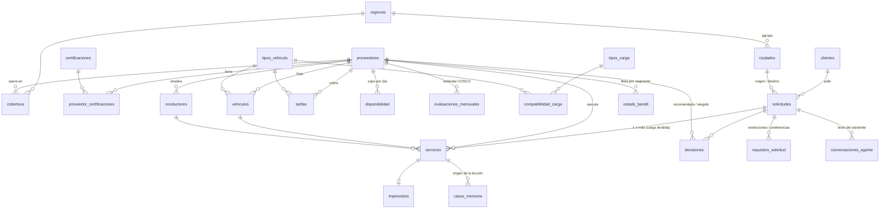

# Modelo de datos

23 tablas en tres grupos. Definidas en `cosco/db/models.py` (SQLAlchemy 2) y probadas en PostgreSQL 16 y SQLite.

## Diagrama

## Tablas

**Catálogos**
| Tabla | Contenido |
|---|---|
| `regiones` | 7 regiones operativas (Caribe, Andina Centro, Antioquia y Eje Cafetero, Pacífico y Valle, Santanderes, Orinoquía, Sur y Amazonía) |
| `ciudades` | 28 ciudades con coordenadas, puerto sí/no, factor de terreno (montaña = más lento) y riesgo vial base |
| `tipos_vehiculo` | 9 tipos: tractomula 40'/20'/reefer, plataforma, cama baja, cisterna, doble troque, sencillo, turbo (capacidad en t y TEU) |
| `tipos_carga` | 7 tipos, cada uno con la certificación que exige y su sensibilidad a daño |
| `compatibilidad_carga` | qué vehículos sirven para cada carga, en orden de preferencia (permite proponer un vehículo alterno) |
| `clientes` | 45 clientes ficticios por sector |

**Proveedores** (15, toda Colombia)
| Tabla | Contenido |
|---|---|
| `proveedores` | datos generales, tiempo de reacción **declarado**, OTD histórico, tiempo de entrega promedio, puntaje de desempeño COSCO (últimos 6 meses) |
| `cobertura`, `proveedor_certificaciones` | regiones donde opera y certificaciones (mercancía peligrosa, cadena de frío, escolta y GPS, permiso de extradimensionada, BASC) |
| `vehiculos` | ~830 vehículos: placa, modelo, estado (Excelente/Bueno/Regular/Malo), puntaje de inspección, kilometraje, GPS |
| `conductores` | ~945 conductores con las 5 métricas COSCO (puntualidad, seguridad vial, documentación, cuidado de la carga, comunicación) y puntaje total |
| `tarifas` | COP/km y cargo fijo por proveedor y tipo de vehículo |
| `disponibilidad` | vehículos libres por proveedor, tipo y día, para los próximos 30 días |

**Operación histórica (para entrenar y validar)**
| Tabla | Contenido |
|---|---|
| `solicitudes` | ~10.000 históricas (24 meses) + **30 de la fase de prueba** (`fase='prueba'`, `estado='pendiente'`) |
| `servicios` | ~10.900 viajes: tiempo planeado vs. real, a tiempo, costo cotizado vs. final, imprevisto, daño y calificación del cliente |
| `imprevistos` | ~1.360: tipo (avería, derrumbe, paro, retención, accidente, falla de frío, hurto), tiempo de reacción **real**, retraso y costo extra |
| `evaluaciones_mensuales` | estándar COSCO por proveedor y mes: OTD 35 %, siniestralidad 20 %, documentación 15 %, comunicación 15 %, cumplimiento de tarifa 15 % |

**Memoria del asistente LLM** (equipo de Medi y Andrea)
| Tabla | Contenido |
|---|---|
| `decisiones` | lo que recomendó el sistema, lo que eligió la persona y por qué, y el resultado cuando se cierra el servicio. Es la retroalimentación del bandido |
| `casos_memoria` | casos y lecciones ("en un caso parecido pasó X y causó Y"): qué pasó, consecuencia, lección, importancia 1-5 y etiquetas. Arranca con 29 lecciones sacadas del historial |

**Motor de decisión** (creadas vacías en Supabase el 23/10/2026, sin tocar los datos sembrados)
| Tabla | Contenido |
|---|---|
| `requisitos_solicitud` | restricciones (descartan) y preferencias (cambian pesos) de cada solicitud, con quién las confirmó |
| `conversaciones_agente` | texto que la persona escribió al asistente y los campos que extrajo el LLM (JSON) |
| `estado_bandit` | Beta(alfa, beta) por proveedor y segmento (región destino × tipo de carga), con fecha de actualización |

Todas las tablas tienen RLS activado y sin políticas: el motor entra con el usuario `postgres` por el Session
pooler y no se ve afectado. Si el dashboard usa la llave pública (anon) de Supabase, hay que crear políticas.

## Cómo se generan los datos (la "verdad oculta")

Cada proveedor tiene parámetros reales que **el motor no ve** (`cosco/db/archetypes.py`, exportados a
`data/verdad_oculta.json` solo para validar). El historial se simula con ellos, así que el motor tiene
que descubrir desde los datos:

- **Fortalezas y debilidades por segmento.** Por ejemplo, Costa Norte Carga es excelente en la Costa y débil
  hacia Antioquia, y Económicos del Valle falla en refrigerados.
- **Tendencias.** Antioquia Freight pasa de 87,7 % a 75,8 % de OTD desde junio de 2026. Santander Trucking
  mejora de 73,2 % a 81,8 %.
- **Pocos datos.** NovaTrans 4.0 empezó en septiembre de 2026, lleva 9 servicios y un 100 % a tiempo. Es el
  caso "3 de 3 no es igual que 300 de 300".
- **Información poco confiable.** El tiempo de reacción declarado es 15-35 % más optimista que el real
  (comparar `proveedores.tiempo_reaccion_prom_h` con `imprevistos.tiempo_reaccion_h`).
- **Factores realistas.** Temporada de lluvias (abril-mayo y octubre-noviembre), riesgo vial por corredor
  (vía al mar en Buenaventura, Mocoa, Arauca, Quibdó), estado del vehículo y puntaje del conductor afectan
  los imprevistos y los daños.
- **Decisiones humanas históricas no óptimas.** Se eligió por precio y costumbre, con ruido. Así el backtest
  puede mostrar cuánto mejora el sistema.

## Cobertura: al menos un proveedor por caso

El seeder verifica, antes de cargar, todos los pares origen-destino (756) × 7 tipos de carga (5.292 casos)
y se detiene si alguno queda sin proveedor que pueda atenderlo (región, vehículo y certificación). Mínimo
de proveedores factibles por caso:

| Tipo de carga | Mínimo | Mediana | Máximo |
|---|---|---|---|
| Contenedor seco | 4 | 6 | 13 |
| Carga suelta / paletizada | 4 | 6 | 12 |
| Mercancía peligrosa (IMO) | 3 | 3 | 5 |
| Alto valor | 2 | 2 | 3 |
| Contenedor refrigerado | 1 | 2 | 4 |
| Carga extradimensionada | 1 | 1 | 3 |
| Granel líquido | 1 | 1 | 3 |

Los casos con un solo proveedor (extradimensionada o granel hacia regiones remotas) son intencionales.
Sirven para el caso "sin opción ideal".

## Casos de demostración que soportan los datos

| Caso | Qué lo hace posible |
|---|---|
| Urgente Buenaventura → Bogotá | ~300 servicios en el corredor, proveedores con distinta velocidad y variabilidad |
| Prioridad costo Cartagena → Medellín | LogiCaribe y Económicos baratos vs. Costa Norte (débil hacia Antioquia) |
| Refrigerado crítico | FríoExpress casi lleno del 24 al 27/10 (1 vehículo libre); alternativas Antioquia Freight, NovaTrans, Sur Cargo |
| Sin vehículo disponible | Carga Pesada Nacional sin cama baja del 24 al 28/10; alternativas: plataforma, otro proveedor o fecha más cercana |
| Carga dividida | Solicitudes de 3-6 contenedores; RutaSegura con máximo 2 tractomulas 40' libres el 25 y 26/10 |
| Proveedor nuevo con pocos datos | NovaTrans 4.0 (9 servicios) |
| Proveedor que empeoró | Antioquia Freight desde junio de 2026 |
| Regiones remotas | Mocoa, Arauca, San José del Guaviare: pocos datos y alto riesgo vial |
